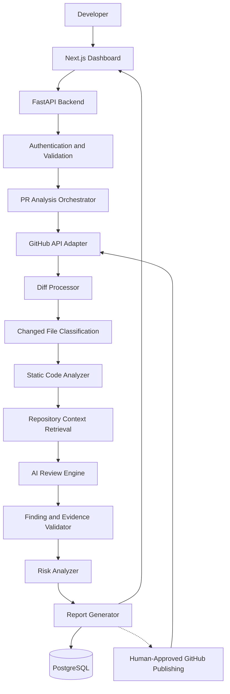

# CodeGuard — System Architecture

- **Document status:** Initial Architecture Draft.
- **Architecture review:** Pending.
- **Next milestone:** Milestone 1 — Project Foundation.

---

## 1. Architecture Overview

CodeGuard is an AI-powered GitHub Pull Request Reviewer designed to analyze code changes, retrieve relevant repository context, identify potential risks, and generate evidence-backed review recommendations.

The application uses a modular backend architecture with a controlled analysis pipeline.

The architecture separates deterministic code analysis from AI-based reasoning.

The system will initially support manual pull request analysis for Python repositories.

Additional languages, automated webhooks, background processing, and frontend functionality will be introduced incrementally.

## 2. Architecture Principles

1. Deterministic analysis handles verifiable code checks.
2. LLMs assist with reasoning and recommendations.
3. Every finding must be supported by repository evidence.
4. AI-generated outputs must pass structured validation.
5. Repository content must be treated as untrusted input.
6. Arbitrary repository code must never be executed.
7. Components must have clearly defined responsibilities.
8. Every important component must be independently testable.
9. RAG and agent orchestration must be introduced only when justified.
10. Human approval is required before publishing GitHub reviews.

## 3. High-Level System Architecture

The system consists of the following major components.

| Component | Responsibility |
|---|---|
| Next.js Frontend | Dashboard and review report interface |
| FastAPI Backend | API endpoints and application coordination |
| Authentication | Secure user and GitHub authorization |
| GitHub Adapter | Communicates with the GitHub REST API |
| Diff Processor | Parses and normalizes PR changes |
| Static Analyzer | Performs deterministic code analysis |
| Repository Context | Retrieves related code and tests |
| AI Review Engine | Generates structured review recommendations |
| Finding Validator | Checks AI findings against repository evidence |
| Risk Analyzer | Calculates explainable PR risk |
| Report Generator | Generates structured review reports |
| PostgreSQL | Stores analysis history and findings |
| Worker | Handles background analysis in later milestones |

## 4. Architecture Diagram

## 5. Pull Request Analysis Data Flow

The initial application will use a manual PR analysis workflow.

### Step 1 — User Request

The user provides:

- GitHub repository.
- Pull request number.

The frontend submits the request to FastAPI.

### Step 2 — GitHub Integration

The GitHub adapter retrieves:

- Repository metadata.
- Pull request metadata.
- Base commit SHA.
- Head commit SHA.
- Changed filenames.
- Available code patches.
- Relevant file contents when required.

GitHub API pagination, rate limits, timeouts, and errors must be handled.

### Step 3 — Diff Processing

The diff processor:

- Parses unified diffs.
- Identifies added lines.
- Identifies removed lines.
- Identifies modified files.
- Preserves source-line information.
- Maintains GitHub-compatible diff positions where possible.

Deleted, renamed, binary, and unavailable files must be handled explicitly.

### Step 4 — Static Code Analysis

The static analyzer processes supported source files.

For Python files, use Python AST to extract:

- Functions.
- Classes.
- Imports.
- Recognizable function calls.
- Source-line information.
- Selected risky patterns.

Identify which functions and classes are affected by the PR.

### Step 5 — Repository Context Retrieval

Retrieve relevant repository evidence:

- Changed function definitions.
- Function callers where feasible.
- Imported dependencies.
- Related implementation files.
- Existing test files.
- Relevant neighboring code.

Initially use deterministic repository search and dependency analysis.

### Step 6 — AI Review

The AI review engine receives a bounded context package.

It can investigate:

- Potential bugs.
- Error handling.
- Security concerns.
- Reliability issues.
- Edge cases.
- Missing test scenarios.
- Design improvements.

The AI engine must return structured findings.

### Step 7 — Finding Validation

Validate each finding against available repository evidence.

Check:

- File existence.
- Source-code evidence.
- Line references.
- Evidence consistency.
- Supported analysis scope.

Reject unsupported findings.

Distinguish deterministic findings from AI-generated potential issues.

### Step 8 — Risk Assessment

Calculate an explainable risk assessment using deterministic signals.

Consider:

- Finding severity.
- Number of affected components.
- Security-sensitive changes.
- Error-handling changes.
- Dependency changes.

### Step 9 — Report Generation

Generate a review report containing:

- PR summary.
- Files analyzed.
- Affected components.
- Findings.
- Evidence.
- Severity.
- Confidence.
- Recommended tests.
- Overall risk.
- Analysis limitations.

### Step 10 — Optional GitHub Publishing

Allow the user to approve the generated review before publishing it to GitHub.

Never automatically approve, reject, or merge a pull request.

## 6. Backend Architecture

The backend will use FastAPI and a modular Python package structure.

### api/

Responsibilities:

- HTTP endpoints.
- Request validation.
- Response serialization.
- API versioning.
- Dependency injection.

### core/

Responsibilities:

- Application settings.
- Environment configuration.
- Logging.
- Security utilities.
- Shared configuration.

### schemas/

Responsibilities:

- Pydantic request models.
- Pydantic response models.
- Review finding schemas.
- Analysis result schemas.

### github/

Responsibilities:

- GitHub API client.
- Authentication handling.
- Repository retrieval.
- Pull request retrieval.
- Changed-file retrieval.
- Rate-limit handling.

### diff/

Responsibilities:

- Unified diff parsing.
- Change classification.
- Added and removed line mapping.
- File rename handling.
- Diff position tracking.

### analyzers/

Responsibilities:

- Python AST analysis.
- Function and class extraction.
- Import extraction.
- Function-call analysis.
- Static risk detection.

Tree-sitter can be introduced later for multi-language parsing.

### context/

Responsibilities:

- Related source retrieval.
- Caller identification.
- Dependency investigation.
- Test discovery.
- Context size management.

### review/

Responsibilities:

- PR analysis orchestration.
- Review findings.
- Finding validation.
- Risk scoring.
- Report generation.

### ai/

Responsibilities:

- AI provider interface.
- Mock provider.
- LLM integration.
- Prompt management.
- Structured output handling.

### db/

Responsibilities:

- SQLAlchemy models.
- Database sessions.
- Database repositories.
- Alembic migrations.

### workers/

Responsibilities:

- Background PR analysis.
- Retry handling.
- Processing status.
- Failure recovery.

This module will be introduced when background processing becomes necessary.

## 7. Proposed API Boundaries

Initial API design:

| Method | Endpoint | Responsibility |
|---|---|---|
| GET | /health | Health check |
| POST | /api/v1/reviews/analyze | Start manual PR analysis |
| GET | /api/v1/reviews/{review_id} | Retrieve analysis report |
| GET | /api/v1/reviews | List analysis history |

These are proposed interfaces. Request and response contracts will be finalized during implementation.

Additional endpoints for repositories, webhooks, and publishing will be added in later milestones.

## 8. Database Architecture

PostgreSQL will store persistent application data.

Proposed entities:

### User

Stores application user information.

### Repository

Stores connected repository metadata and ownership information.

### PullRequest

Stores repository reference, PR number, branch information, and commit identifiers.

### Analysis

Stores analysis execution status, timestamps, and overall risk assessment.

### Finding

Stores review findings, severity, confidence, evidence, and source-line references.

### TestRecommendation

Stores recommended test scenarios and their supporting evidence.

### WebhookEvent

Stores webhook event identifiers and processing status for deduplication.

Database models and relationships will be implemented during Milestone 7.

GitHub access tokens must not be stored as plaintext.

Do not persist entire repository contents unnecessarily.

## 9. AI Review Architecture

The AI review engine will use a provider abstraction.

Initial development:

- Implement a deterministic mock provider.
- Define Pydantic review schemas.
- Create repeatable test fixtures.
- Test malformed model outputs.
- Validate findings independently of the provider.

Later:

- Integrate a real LLM provider.
- Use structured model outputs.
- Implement bounded retries and timeouts.
- Measure token consumption.
- Evaluate precision and false positives.

The AI provider must never determine whether its own findings are valid.

Finding validation remains a separate deterministic responsibility.

## 10. Security Architecture

The application must follow these security principles.

### GitHub Security

- Use a GitHub App for production integration.
- Apply least-privilege permissions.
- Protect credentials.
- Validate webhook signatures.
- Avoid unnecessary access to repository data.

### Repository Security

- Treat source files as untrusted input.
- Reject path traversal.
- Apply file-size limits.
- Filter sensitive files.
- Avoid executing repository code.
- Avoid installing untrusted dependencies.

### AI Security

- Treat code, comments, commit messages, and PR descriptions as untrusted data.
- Protect against prompt injection.
- Redact secrets before sending context to an external model.
- Validate all structured outputs.
- Reject unsupported findings.

### Application Security

- Validate all API inputs.
- Keep secrets outside Git.
- Use environment-based configuration.
- Apply timeouts and resource limits.
- Protect sensitive logs.

## 11. Reliability and Error Handling

The system must implement:

- HTTP timeouts.
- Bounded retry policies.
- Exponential backoff where appropriate.
- GitHub rate-limit handling.
- Structured logging.
- Graceful error handling.
- Idempotent processing.
- Database transactions.
- Analysis status tracking.
- Concurrency limits.
- Recovery from partial analysis failures.

A failed AI request must not erase successfully collected deterministic evidence.

## 12. Technology Stack

| Component | Technology |
|---|---|
| Language | Python 3.12 |
| Backend | FastAPI |
| Frontend | Next.js, React, TypeScript |
| API client | HTTPX |
| GitHub | GitHub REST API |
| Code parsing | Python AST |
| Multi-language parsing | Tree-sitter |
| AI | OpenAI API |
| Validation | Pydantic |
| Database | PostgreSQL |
| ORM | SQLAlchemy |
| Migrations | Alembic |
| Testing | Pytest |
| Frontend testing | Vitest and Playwright |
| Dependency management | uv |
| CI/CD | GitHub Actions |
| Containers | Docker and Docker Compose |
| Monitoring | Structured logging and metrics |

LangGraph, MCP, RAG, and vector databases are optional architectural extensions, not initial dependencies.

They will be introduced only when a measurable engineering requirement justifies them.

## 13. Development Architecture Phases

The implementation will follow the development milestones.

| Phase | Main responsibility |
|---|---|
| M0 | Requirements and architecture |
| M1 | Backend project foundation |
| M2 | GitHub integration |
| M3 | Static code analysis |
| M4 | Repository context |
| M5 | AI review engine |
| M6 | Risk analysis and test recommendations |
| M7 | Database and persistence |
| M8 | Webhooks and background processing |
| M9 | Frontend |
| M10 | GitHub review publishing |
| M11 | Evaluation and reliability |
| M12 | Production deployment |
| M13 | Portfolio and interview preparation |

Implement and test each milestone before progressing.

## 14. Existing Project Reuse Strategy

CodeGuard will be developed as an independent repository.

Existing projects will be used selectively as engineering references.

| Repository | Reusable concepts |
|---|---|
| AI Codebase Assistant MCP | Python AST, MCP security, AI provider abstraction |
| SupportFlow AI | FastAPI, PostgreSQL, SQLAlchemy, Alembic, frontend patterns |
| FastAPI Docker Deployment | Docker and deployment patterns |

The existing repositories will remain independent.

CodeGuard will implement its own:

- GitHub PR integration.
- Diff processing.
- PR analysis pipeline.
- Repository context retrieval.
- AI review engine.
- Evidence validation.
- Risk analysis.
- Evaluation benchmark.

No existing application will become a runtime dependency of CodeGuard.

All reused code must be reviewed, tested and adapted to CodeGuard's requirements.

## 15. Architecture Decisions and Constraints

1. Start with a modular monolithic backend.
2. Start with manual PR analysis.
3. Support Python repositories initially.
4. Use deterministic repository retrieval before introducing RAG.
5. Use a mock AI provider before configuring paid AI APIs.
6. Avoid multi-agent orchestration initially.
7. Introduce background workers when required.
8. Add PostgreSQL during the persistence milestone.
9. Keep GitHub publishing behind explicit human approval.
10. Avoid microservices and Kubernetes without a concrete requirement.

---

**Document status:** Initial Architecture Draft.  
**Architecture review:** Pending.  
**Next milestone:** Milestone 1 — Project Foundation.
