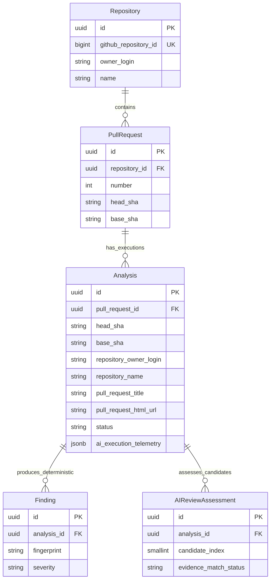

# CodeGuard Database Schema Design

**Status:** Proposed design for review

**Scope:** PostgreSQL application data model for Milestone 7.2.1

**Implementation status:** Design only; no SQLAlchemy models or migrations are included.

## 1. Design overview

The proposed PostgreSQL schema stores repository and pull-request metadata,
immutable analysis executions, deterministic findings, and independently assessed
AI candidates with their candidate-level validation recommendations. It preserves
each execution and distinguishes deterministic findings from unconfirmed AI
proposals.

The five entities are `Repository`, `PullRequest`, `Analysis`, `Finding`, and
`AIReviewAssessment`. No `User` entity is proposed:
there is no implemented authentication requirement to justify one.

Use SQLAlchemy 2.x declarative mappings and PostgreSQL-specific types where needed:
`UUID(as_uuid=True)`, timezone-aware `DateTime`, and `JSONB`. Use UUID primary keys
generated by the application. Use `VARCHAR` plus `CHECK` constraints for the
currently small status/severity vocabularies rather than PostgreSQL enum types;
this avoids requiring enum DDL changes as those values evolve.

This design stores repository metadata and bounded evidence excerpts, not repository
source trees, full diffs, or retrieved context. Database credentials and GitHub
access tokens are secrets/configuration and are not columns in these entities.

### Common conventions

- All timestamps are timezone-aware PostgreSQL `TIMESTAMPTZ` values stored in UTC.
- `created_at` is non-null and defaults to `now()`. `updated_at` is non-null and is
  advanced on updates. The database-trigger versus SQLAlchemy-update mechanism is
  an implementation decision to confirm.
- `github_created_at` and `github_updated_at` are nullable external timestamps;
  they are distinct from the database's own audit timestamps.
- Status and severity strings are lowercase, matching current Pydantic contracts.
- UUIDs are internal identifiers. GitHub's numeric repository ID and pull-request
  number remain external identifiers with their own uniqueness constraints.

## 2. Entity definitions

### Repository

One GitHub repository known to CodeGuard. It stores stable GitHub identity and
small amounts of metadata needed to display and resolve reviews. The GitHub
repository ID is the primary external identity; owner/name are mutable display
metadata.

### PullRequest

One pull request in a repository, identified by its repository and GitHub PR
number. It stores the latest known PR metadata and current head/base branch and
commit references. These current values are not a substitute for analysis history.

### Analysis

One execution of the analyzer for a pull request. Each row stores the exact base
and head commit SHAs used for that execution, immutable repository/PR display
metadata snapshots, its lifecycle timestamps/status, and report-level metadata.
Multiple rows for the same PR and same head SHA are allowed for retries, re-runs,
or changed analysis versions.

### Finding

One deterministic `ReviewFinding` produced during one analysis. The fingerprint
is persisted exactly as computed by the existing deterministic algorithm. A
finding is not shared or overwritten across analyses.

### AIReviewAssessment

One untrusted AI candidate paired with its independent evidence-match result in
one analysis. This table is deliberately separate from `Finding`; an AI candidate
does not become a confirmed finding by being stored or by receiving a `matched`
evidence status. The candidate's own `recommended_validation` field is stored
here; it is not an independent recommendation collection.

## 3. Field-level schema

The tables below specify recommended SQLAlchemy types and nullability. Lengths
follow current contracts where they are explicit; `TEXT` is used where the domain
does not establish a safe maximum. `CHECK` constraints are described in section 5.

### `repositories`

| Column | SQLAlchemy / PostgreSQL type | Nullability / default | Notes |
|---|---|---|---|
| `id` | `UUID(as_uuid=True)` | PK, not null | Application-generated UUID. |
| `github_repository_id` | `BigInteger` | Not null, unique | Stable GitHub repository ID. |
| `owner_login` | `String(100)` | Not null | Current owner login; GitHub AI input contract allows 100 characters. |
| `name` | `String(100)` | Not null | Repository name. |
| `private` | `Boolean` | Not null | GitHub repository visibility flag. |
| `html_url` | `Text` | Not null | Canonical GitHub URL. |
| `description` | `Text` | Nullable | GitHub description. |
| `default_branch` | `String(255)` | Nullable | GitHub default branch when available. |
| `language` | `String(100)` | Nullable | GitHub's optional primary-language metadata. |
| `github_created_at` | `DateTime(timezone=True)` | Nullable | GitHub-provided repository creation time. |
| `github_updated_at` | `DateTime(timezone=True)` | Nullable | GitHub-provided repository update time. |
| `created_at` | `DateTime(timezone=True)` | Not null, `now()` | CodeGuard row creation time. |
| `updated_at` | `DateTime(timezone=True)` | Not null, `now()` | CodeGuard row update time. |

### `pull_requests`

| Column | SQLAlchemy / PostgreSQL type | Nullability / default | Notes |
|---|---|---|---|
| `id` | `UUID(as_uuid=True)` | PK, not null | Application-generated UUID. |
| `repository_id` | `UUID(as_uuid=True)` | Not null, FK | References `repositories.id`. |
| `number` | `Integer` | Not null | Positive GitHub pull-request number. |
| `title` | `Text` | Not null | Current PR title. |
| `body` | `Text` | Nullable | PR description/body. |
| `html_url` | `Text` | Not null | Canonical PR URL. |
| `state` | `String(16)` | Not null | `open` or `closed`. |
| `is_draft` | `Boolean` | Not null, `false` | Maps GitHub's `draft`. |
| `is_merged` | `Boolean` | Nullable | Nullable to preserve an unknown/unavailable GitHub value. |
| `head_ref` | `Text` | Not null | Current head branch reference. |
| `head_sha` | `String(64)` | Not null | Current head commit SHA as returned by GitHub. |
| `base_ref` | `Text` | Not null | Current base branch reference. |
| `base_sha` | `String(64)` | Not null | Current base commit SHA as returned by GitHub. |
| `github_created_at` | `DateTime(timezone=True)` | Nullable | GitHub-provided PR creation time. |
| `github_updated_at` | `DateTime(timezone=True)` | Nullable | GitHub-provided PR update time. |
| `created_at` | `DateTime(timezone=True)` | Not null, `now()` | CodeGuard row creation time. |
| `updated_at` | `DateTime(timezone=True)` | Not null, `now()` | CodeGuard row update time. |

### `analyses`

| Column | SQLAlchemy / PostgreSQL type | Nullability / default | Notes |
|---|---|---|---|
| `id` | `UUID(as_uuid=True)` | PK, not null | Application-generated UUID. |
| `pull_request_id` | `UUID(as_uuid=True)` | Not null, FK | References `pull_requests.id`. |
| `head_sha` | `String(64)` | Not null | Immutable head SHA used for this execution. |
| `base_sha` | `String(64)` | Not null | Immutable base SHA used for this execution. |
| `repository_owner_login` | `String(100)` | Not null | Owner login snapshot used for this report. |
| `repository_name` | `String(100)` | Not null | Repository name snapshot used for this report. |
| `pull_request_title` | `Text` | Not null | PR title snapshot used for this report. |
| `pull_request_html_url` | `Text` | Not null | PR URL snapshot used for this report. |
| `status` | `String(16)` | Not null | `queued`, `running`, `succeeded`, `partial`, `failed`, or `cancelled`. |
| `started_at` | `DateTime(timezone=True)` | Nullable | Null while queued; set when execution starts. |
| `completed_at` | `DateTime(timezone=True)` | Nullable | Null while queued/running; set on every terminal state. |
| `files_analyzed` | `Integer` | Not null, `0` | Count from the review report. |
| `files_with_unavailable_mapping` | `JSONB` | Not null, `'[]'::jsonb` | JSON array of repository-relative path strings. |
| `repository_context` | `JSONB` | Nullable | Structured `RepositoryContextResponse` snapshot metadata; never source contents. |
| `ai_review_summary` | `Text` | Nullable | `AIReviewResult.summary` when an AI result exists. |
| `ai_execution_telemetry` | `JSONB` | Nullable | One `AIExecutionTelemetry` value; unknown measurements remain JSON `null`. |
| `created_at` | `DateTime(timezone=True)` | Not null, `now()` | CodeGuard row creation time. |
| `updated_at` | `DateTime(timezone=True)` | Not null, `now()` | CodeGuard row update time. |

The four repository/PR metadata snapshot columns preserve the identity and display
metadata used to generate this historical review report, even if the repository
owner/name or pull-request title/URL later changes on GitHub. They are immutable
for an analysis after its report has been generated.

Lifecycle transitions are `queued -> running -> (succeeded | partial | failed |
cancelled)`. A queued analysis may instead transition directly to `failed` or
`cancelled` if it cannot start. Terminal statuses do not transition; a retry or
re-run creates a new analysis row. `succeeded` means all requested analysis stages
completed; `partial` means a usable report was produced but one or more requested
stages or files could not be fully analyzed; `failed` means no usable report was
produced; `cancelled` means execution was stopped before completion.

Timestamp invariants:

- `queued`: `started_at` and `completed_at` are null.
- `running`: `started_at` is non-null and `completed_at` is null.
- `succeeded` and `partial`: both timestamps are non-null.
- `failed` and `cancelled`: `completed_at` is non-null; `started_at` may be null
  only when termination happened before execution began.
- When both are present, `completed_at >= started_at`.

`repository_context`, when present, is a JSON object with the existing response
shape: `commit_sha`, `is_complete`, `indexed_file_count`, `tree_truncated`,
`file_limit_reached`, and `failures` (each with `file_path`, `stage`, and
`error_type`). A JSON object is useful here to preserve this single structured
API value without creating additional tables for one report-level snapshot.
Persist only safe failure metadata in `failures`: a sanitized error type and the
contract's stage/path fields. Never include exception messages, stack traces,
causes, credentials, or other secret-bearing text.

`ai_execution_telemetry`, when present, is a JSON object matching the existing
`AIExecutionTelemetry` contract:

| JSON key | Value shape |
|---|---|
| `provider_identity` | String or `null`. |
| `model_identity` | String or `null`. |
| `provider_usage` | Object or `null`; when present contains non-negative integer `input_tokens`, `output_tokens`, and `total_tokens`, plus nullable non-negative integer `cached_input_tokens`. |
| `provider_request_duration_ms` | Finite non-negative number or `null`. |
| `total_ai_execution_duration_ms` | Finite non-negative number or `null`. |
| `queue_waiting_duration_ms` | Finite non-negative number or `null`. |
| `measurement_source` | `provider`, `synthetic`, `runtime`, or `unknown`, as defined by the contract. |

Unknown measurements stay `null`; do not infer them from other durations. The
`measurement_source` records the contract's source label. Pricing configuration
and costs are not part of the production review result contract and are not stored
here.

### `findings`

| Column | SQLAlchemy / PostgreSQL type | Nullability / default | Notes |
|---|---|---|---|
| `id` | `UUID(as_uuid=True)` | PK, not null | Application-generated UUID. |
| `analysis_id` | `UUID(as_uuid=True)` | Not null, FK | References `analyses.id`. |
| `fingerprint` | `String(64)` | Not null | Existing lowercase SHA-256 deterministic finding fingerprint. |
| `rule_id` | `String(100)` | Not null | Stable analyzer rule identifier. |
| `title` | `Text` | Not null | Finding title. |
| `severity` | `String(8)` | Not null | `critical`, `high`, `medium`, `low`, or `info`. |
| `confidence` | `String(8)` | Not null | `low`, `medium`, or `high`. |
| `message` | `Text` | Not null | Finding message. |
| `description` | `Text` | Not null | Rule description. |
| `file_path` | `Text` | Not null | Repository-relative path. |
| `line_number` | `Integer` | Not null | One-based positive source line. |
| `cwe` | `String(32)` | Not null | CWE identifier. |
| `evidence` | `Text` | Not null | Bounded-by-domain source evidence excerpt; not a full file. |
| `remediation` | `Text` | Not null | Remediation guidance. |
| `references` | `JSONB` | Not null | Non-empty JSON array of reference strings. |
| `created_at` | `DateTime(timezone=True)` | Not null, `now()` | Persistence timestamp. |

### `ai_review_assessments`

| Column | SQLAlchemy / PostgreSQL type | Nullability / default | Notes |
|---|---|---|---|
| `id` | `UUID(as_uuid=True)` | PK, not null | Application-generated UUID. |
| `analysis_id` | `UUID(as_uuid=True)` | Not null, FK | References `analyses.id`. |
| `candidate_index` | `SmallInteger` | Not null | Zero-based candidate order from the AI result. |
| `title` | `String(200)` | Not null | AI candidate title. |
| `severity` | `String(8)` | Not null | `critical`, `high`, `medium`, `low`, or `info`. |
| `confidence` | `String(8)` | Not null | `low`, `medium`, or `high`. |
| `file_path` | `String(500)` | Not null | Candidate repository-relative POSIX path. |
| `line_number` | `Integer` | Not null | AI-proposed one-based line; not inherently verified. |
| `problem` | `String(3000)` | Not null | Candidate problem description. |
| `evidence` | `String(4000)` | Not null | Candidate source excerpt, preserving meaningful whitespace. |
| `why_it_matters` | `String(2000)` | Not null | Candidate impact rationale. |
| `suggested_fix` | `String(3000)` | Not null | Candidate suggested fix. |
| `recommended_validation` | `String(2000)` | Not null | Existing candidate-level validation recommendation; not an independent collection. |
| `evidence_match_status` | `String(16)` | Not null | `matched`, `mismatched`, or `unverifiable`. |
| `evidence_match_reason` | `String(32)` | Not null | `exact_match`, `content_mismatch`, `location_invalid`, or `location_unverifiable`. |
| `location_reason` | `String(32)` | Nullable | Optional location-validation reason, listed below. |
| `created_at` | `DateTime(timezone=True)` | Not null, `now()` | Persistence timestamp. |

Allowed `location_reason` values are `location_valid`, `file_not_found`,
`source_retrieval_failed`, `source_omitted`, `incomplete_snapshot`,
`unsupported_file_type`, `line_out_of_range`, and `commit_mismatch`.

`EvidenceMatchResult` uses the candidate's `file_path` and `line_number` for its
location. API reconstruction therefore reuses those stored candidate fields;
the independently computed `evidence_match_status`, `evidence_match_reason`, and
optional `location_reason` remain separately persisted.

`recommended_validation` is the existing required field on each
`AIFindingCandidate`. It is stored on the assessment itself and does not represent
a production-generated top-level recommendation collection. A standalone
`TestRecommendation` entity is deferred until production has an independent
recommendation contract.

## 4. Relationship diagram

## 5. Constraints and indexes

### Primary, foreign, and unique constraints

- Primary key: `id` on all five tables.
- `repositories.github_repository_id` is unique.
- `owner_login` and `name` are mutable repository metadata, not stable identity;
  they are indexed non-uniquely. `github_repository_id` remains the unique stable
  external identity.
- `pull_requests(repository_id, number)` is unique.
- `findings(analysis_id, fingerprint)` is unique. The same fingerprint may
  legitimately occur in a later analysis.
- `ai_review_assessments(analysis_id, candidate_index)` is unique.

### Check constraints

- `pull_requests.number > 0`; `state IN ('open', 'closed')`.
- `analyses.status IN ('queued', 'running', 'succeeded', 'partial', 'failed', 'cancelled')`.
- `analyses.files_analyzed >= 0`.
- Both analysis SHA columns are non-empty and at most 64 characters.
- Apply the status/timestamp invariants in section 3: queued has neither timestamp;
  running has only `started_at`; succeeded/partial require both; failed/cancelled
  require `completed_at` and may omit `started_at` only if they ended before start.
  When both exist, `completed_at >= started_at`.
- `analyses.ai_execution_telemetry`, when present, is a JSON object with the
  contract's keys and value types described in section 3. Missing measurements
  are represented as JSON `null`; duration values are finite and non-negative;
  token values are non-negative integers and `total_tokens` equals input plus
  output tokens.
- `findings.fingerprint` matches `^[0-9a-f]{64}$`; `line_number > 0`.
- Finding and AI-assessment severities are one of `critical`, `high`, `medium`,
  `low`, `info`; confidence is one of `low`, `medium`, `high`.
- `findings.references` is a non-empty JSON array.
- `analyses.files_with_unavailable_mapping` is a JSON array of strings;
  `analyses.repository_context`, when present, is a JSON object.
- `ai_review_assessments.recommended_validation` is non-null and at most 2,000
  characters.
- AI assessment `candidate_index` is in `[0, 49]`, matching the current maximum
  candidate count of 50; candidate line numbers are positive.
- Evidence status/reason pairs are consistent with the contract:
  `matched` requires `exact_match`; `mismatched` requires `content_mismatch` or
  `location_invalid`; `unverifiable` requires `location_unverifiable`.
- AI assessment `location_reason`, when present, is one of the enumerated
  location reasons in section 3.

### Recommended indexes

- `pull_requests(repository_id, state, github_updated_at DESC)` for repository
  PR listing.
- `analyses(pull_request_id, created_at DESC)` for analysis history.
- Non-unique `analyses(pull_request_id, head_sha)` for looking up executions by
  commit while allowing repeated analyses.
- `findings(analysis_id, severity)` and `findings(analysis_id, file_path, line_number)`
  for report filtering and navigation.
- `ai_review_assessments(analysis_id, evidence_match_status)` for candidate and
  evidence-status filtering.
- Non-unique B-tree index on `repositories(owner_login, name)` for metadata
  lookup; it must not enforce owner/name uniqueness.
- Do not add GIN indexes to JSONB fields until a real JSON-path query requires
  them; current report use is whole-value serialization/retrieval.

## 6. Data integrity rules

1. **Keep AI candidates separate.** Only deterministic `ReviewFinding` values are
   stored in `findings`. AI proposals are stored only in
   `ai_review_assessments`; no foreign-key or status transition promotes a
   candidate into a confirmed finding.
2. **Evidence is independent.** Persist evidence status, machine-readable match
   reason, and optional location reason as separate fields. Reuse the candidate's
   stored `file_path` and `line_number` as the assessed location, as the existing
   `EvidenceMatchResult` does. `matched` means the candidate's evidence and
   location matched the snapshot; it does not mean the underlying issue is true
   or confirmed.
3. **Preserve each execution.** Insert a new `Analysis` for each run, even when
   the PR head SHA has not changed. Do not update prior findings or assessments
   in place. A partial/failed retry must not erase a prior completed report.
4. **Pin results to immutable commits.** `Analysis.head_sha` and `base_sha` record
   the exact input revision and must never be refreshed from the mutable
   `PullRequest` row. Evidence must be assessed against that analysis's head
   snapshot. A PR head change updates only the current PR metadata and starts a
   new analysis row.
5. **Preserve the current fingerprint.** Persist the exact deterministic
   lowercase SHA-256 fingerprint produced by the existing rule/path/line
   algorithm. Do not salt it, regenerate it with a new algorithm, or make it
   globally unique. A future fingerprint-version migration requires an explicit
   compatibility plan.
6. **Keep recommendations correctly sourced.** In the current production
   contract, persist `recommended_validation` as a field on the corresponding
   `AIReviewAssessment`. Do not invent a top-level recommendation collection or
   represent evaluation labels as product recommendations.
7. **Minimize retained source material.** Store only the finding/candidate
   evidence excerpts required by the existing contracts. Do not persist whole
   files, repository trees, or full diffs in these tables.
8. **Avoid credential persistence.** The schema has no token or API-key columns.
   GitHub credentials and provider secrets must remain in the configured secret
   store/environment and be redacted from logs.
9. **Retain safe failure metadata only.** Persist analysis status and, where
   applicable, sanitized repository-context `file_path`, `stage`, and
   `error_type` values. Never persist raw exception messages/traces, chained
   causes, request/response secrets, or credentials.

## 7. Deletion and retention strategy

- Deleting a repository with pull requests is `RESTRICT`; deleting a pull request
  with analyses is also `RESTRICT`. This prevents routine parent deletion from
  silently removing review history.
- Deleting an `Analysis` explicitly cascades to its `Finding` and
  `AIReviewAssessment` rows.
- Routine disconnect/archive operations should retain the repository and history;
  no hard-delete workflow is implied by this schema. If a legal/privacy erasure
  workflow is required, it should explicitly remove analyses/children first and
  then PR and repository rows in a transaction.
- Keep commit SHAs and findings as historical report metadata. Their presence
  does not imply that CodeGuard retains or can reconstruct the corresponding
  source tree.
- Evidence excerpts are repository-derived data and should follow a reviewed
  retention policy. The concrete retention period, backup retention, and any
  repository archival marker remain open decisions.

## 8. Open design decisions

1. **Analysis lifecycle:** The proposed persistence statuses
   (`queued`, `running`, `succeeded`, `partial`, `failed`, `cancelled`) and
   transitions/timestamp invariants are not currently defined by
   `PullRequestAnalysisResult` or the review API. Confirm the lifecycle,
   especially the operational criteria for `partial`, before implementation.
2. **Standalone recommendations:** Defer a separate recommendation entity until
   production defines an independent recommendation contract. That contract
   should specify ownership/linkage, cardinality, and lifecycle.
3. **PostgreSQL and existing SQLite stores:** The application has a SQLAlchemy
   PostgreSQL engine, while durable webhook delivery and AI-operation execution
   currently use SQLite. Decide whether those operational stores remain separate
   or are migrated later; this design does not duplicate their lease/result
   records in PostgreSQL.
4. **Retention and erasure:** Set retention periods for analysis history and
   repository-derived evidence, including backups and user-requested deletion
   behavior.
5. **`updated_at` implementation:** Select a database trigger or an application/
   SQLAlchemy-managed update mechanism and apply it consistently to all writers.
6. **Metadata freshness:** Confirm whether GitHub metadata is refreshed on every
   analysis and whether only the latest PR/repository metadata is sufficient;
   historical commit SHAs themselves are retained per analysis regardless.

## 9. Mapping to existing application contracts

| Existing contract/data | Proposed persistence mapping |
|---|---|
| `GitHubRepository` | `Repository`: GitHub ID, name, owner login, visibility, URL, description, default branch, language, and nullable GitHub timestamps. `full_name` is derivable from owner/name and need not be duplicated. |
| `GitHubPullRequest` / `GitHubBranchReference` | `PullRequest`: number, state, title/body, draft/merged state, URL, current head/base refs and SHAs, and nullable GitHub timestamps. The transient `mergeable` value is not persisted. |
| `PullRequestAnalysisResult` | `Analysis`: per-execution PR link, immutable base/head SHA, repository owner/name and PR title/URL snapshots, execution status/timestamps, file count, repository context metadata, AI summary, and nullable AI execution telemetry. Its per-file AST objects and source files are intentionally not persisted by these five entities. |
| `FileAnalysisResult` | File-level counts/errors are not given a dedicated entity in this design. Report-level `files_analyzed` and `files_with_unavailable_mapping` are persisted; storing full per-file execution detail would require a separately reviewed entity. |
| `ReviewFinding` / `ReviewReport` | `Finding` stores every deterministic finding's fingerprint, rule/severity/confidence, message/description, location, evidence, remediation, and reference collection. `Analysis` stores report-level counts/summary/context. Severity counts and total findings can be derived from its findings. |
| `ReviewFindingResponse` | Same fields as `Finding`; `references` is represented as a JSONB string array. API shape is unchanged by this design. |
| `AIReviewResult` / `AIFindingCandidate` | One `AIReviewAssessment` per candidate, preserving candidate order and all candidate fields, including `recommended_validation`. The result summary is `Analysis.ai_review_summary`. |
| `AIReviewFindingAssessment` / `EvidenceMatchResult` | Evidence status, reason, and optional location reason are persisted independently on `AIReviewAssessment`. The evidence-match path and line reuse the candidate's stored `file_path` and `line_number`. These values do not change the candidate into a deterministic finding. |
| `AIReviewExecutionResult` / `AIExecutionTelemetry` | `Analysis.ai_execution_telemetry` stores provider/model identity, optional provider usage, durations, and measurement source. Unknown measurements remain null; pricing and costs are not stored. |
| Review API `AIReviewAssessmentResponse` / `EvidenceMatchResponse` | Candidate fields, including `recommended_validation`, are reconstructed from `AIReviewAssessment`; evidence path/line reuse candidate fields while status, reason, and optional location reason map to separate assessment columns. |
| Review API repository context and unavailable mapping | `Analysis.repository_context` stores only the structured context metadata; `files_with_unavailable_mapping` stores a JSONB array. No retrieved source content is stored. |
| Production test-validation contract | Each candidate's required `recommended_validation` is stored directly on its `AIReviewAssessment`. There is no current top-level production recommendation collection; defer a standalone entity until such a contract exists. |
| Evaluation `recommended_test_scenarios` | These values are benchmark ground truth, not production output. Keep them in the versioned evaluation dataset/evaluation workflow and outside production persistence. |
| Existing SQLite webhook and AI-operation repositories | Outside these five PostgreSQL entities and unchanged by this design. Their migration/convergence is an open operational decision, not a reason to alter current SQLite behavior in this milestone. |
